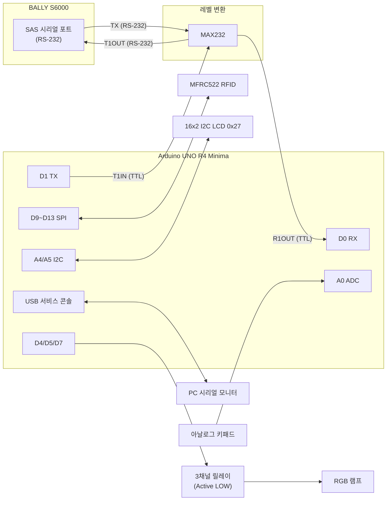

# BALLY S6000 + Arduino UNO R4 Minima SAS 컨트롤러

**빌드:** `S6000-R4-MINIMA-V6.5.14-RAM-AUTO-CLEAR`

Arduino UNO R4 Minima에서 MAX232를 거쳐 BALLY S6000과 SAS 프로토콜(19200 bps, 9N1, 진짜 9-bit UART)로 통신하는 RFID 입금/출금 컨트롤러입니다.

- RFID → S6000 입금: Legacy Bonus `0x8A` 전송 후 LP1A 미터로 검증
- S6000 → RFID 출금: AFT LP72 machine→host full cashout 후 LP1A로 검증
- 거래/Recovery 상태는 **RAM에만 저장** (EEPROM에는 검증된 S6000 프로파일만 저장)
- 명확한 무이동(NO-MOVEMENT) 실패는 RAM 거래를 자동으로 초기화

---

## 파일 구성

Arduino IDE에서는 `BALLY_S6000_END_2026_08_15/BALLY_S6000_END_2026_08_15.ino`를 열면 됩니다.

| 파일 (`BALLY_S6000_END_2026_08_15/`) | 설명 |
|---|---|
| [`BALLY_S6000_END_2026_08_15.ino`](BALLY_S6000_END_2026_08_15/BALLY_S6000_END_2026_08_15.ino) | 메인 스케치 |
| [`BALLY_S6000_UNO_R4_V6_CONFIG.h`](BALLY_S6000_END_2026_08_15/BALLY_S6000_UNO_R4_V6_CONFIG.h) | 빌드 설정 (기능 on/off) |
| [`VALIDATE_V6514.py`](BALLY_S6000_END_2026_08_15/VALIDATE_V6514.py) | 정적 검증 스크립트 |
| `VALIDATION_REPORT_KO.txt` / `VALIDATION_STATIC_OUTPUT.txt` | 검증 결과 |
| [`README_KO.txt`](BALLY_S6000_END_2026_08_15/README_KO.txt) | V6.5.14 변경 내역 원문 |

---

## 하드웨어 구성

| 부품 | 사양 |
|---|---|
| MCU | Arduino UNO R4 Minima (Renesas RA4M1, 5V 로직) |
| 레벨 변환 | MAX232 (TTL ↔ RS-232) + 콘덴서 1µF × 4 (+ 전원 바이패스 0.1µF) |
| RFID | MFRC522 모듈 (13.56MHz, MIFARE Classic) |
| 디스플레이 | 16×2 I2C LCD (PCF8574 백팩, 주소 `0x27`) |
| 키패드 | 4×3 아날로그 저항 분배 키패드 (A0 1선식) |
| 표시등 | 3채널 릴레이 모듈 (Active LOW) → RGB 램프 |

---

## 핀 배치

| UNO R4 핀 | 연결 대상 | 비고 |
|---|---|---|
| D0 (RX, `Serial1`) | MAX232 R1OUT (pin 12) | S6000 TX → MAX232 → UNO |
| D1 (TX, `Serial1`) | MAX232 T1IN (pin 11) | UNO → MAX232 → S6000 RX |
| D4 | 릴레이 IN1 – BLUE | LOW = ON |
| D5 | 릴레이 IN2 – RED | LOW = ON |
| D7 | 릴레이 IN3 – GREEN | LOW = ON |
| D9 | MFRC522 RST | |
| D10 | MFRC522 SDA(SS) | |
| D11 | MFRC522 MOSI | |
| D12 | MFRC522 MISO | |
| D13 | MFRC522 SCK | |
| A0 | 아날로그 키패드 출력 | 12-bit ADC |
| A4 (SDA) | LCD SDA | |
| A5 (SCL) | LCD SCL | |
| 3.3V | MFRC522 3.3V | **5V 연결 금지** |
| 5V | MAX232 VCC, LCD VCC, 키패드, 릴레이 VCC | |
| GND | 모든 모듈 GND + S6000 시리얼 GND | 공통 접지 필수 |

> USB `Serial`은 서비스 콘솔로 사용되고, S6000 통신은 D0/D1의 `Serial1`을 사용합니다. 업로드는 USB로 하므로 D0/D1을 연결한 상태에서도 업로드가 가능합니다.

---

## 전체 블록 다이어그램



---

## 상세 회로도

### 1. SAS 통신부 (UNO R4 ↔ MAX232 ↔ S6000)

```text
                         +5V
                          |
                    +-----+------+ 0.1uF
                    |    16 VCC  |---||--- GND
     C1 1uF         |            |
   +--||--+         |            |
   |  +   |    1 ---| C1+        |
   |      +--- 3 ---| C1-        |
                    |            |
     C2 1uF         |            |
   +--||--+    4 ---| C2+        |
   |  +   |         |            |
   |      +--- 5 ---| C2-        |
                    |            |
   C3 1uF (+) 2 ----| V+         |---||--- +5V   (C3: V+ 와 +5V 사이)
   C4 1uF (-) 6 ----| V-         |---||--- GND   (C4: V- 와 GND 사이)
                    |            |
 UNO D1 (TX) ---11--| T1IN  T1OUT|--14------------> S6000 SAS RX
 UNO D0 (RX) <--12--| R1OUT  R1IN|--13<------------ S6000 SAS TX
                    |            |
                    |    15 GND  |--+-------------- S6000 SAS GND
                    +------------+  |
                         MAX232     |
 UNO GND ---------------------------+
```

- MAX232(무접미사)는 1µF, MAX232A는 0.1µF 콘덴서 사용 가능
- S6000 쪽 SAS 커넥터(DB9 등) 핀 번호는 기기 매뉴얼/하네스로 반드시 확인하세요. 일반적인 DB9 DTE 기준이면 2 = RX, 3 = TX, 5 = GND 입니다. 통신이 안 되면 TX/RX를 서로 바꿔 봅니다.
- 통신 설정: **19200 bps, 9N1** (첫 바이트 wakeup 9번째 비트 = 1), SAS 주소 `01`

### 2. RFID (MFRC522)

```text
   MFRC522 모듈                UNO R4 Minima
  +-------------+
  | SDA (SS)    |------------- D10
  | SCK         |------------- D13
  | MOSI        |------------- D11
  | MISO        |------------- D12
  | IRQ         |   (미사용)
  | GND         |------------- GND
  | RST         |------------- D9
  | 3.3V        |------------- 3.3V   ※ 5V 연결 금지
  +-------------+
```

> MFRC522는 3.3V 소자입니다. UNO R4 Minima의 신호는 5V이므로 장기 안정성을 원하면 SCK/MOSI/SS/RST 라인에 레벨 시프터(또는 분압 저항)를 넣는 것을 권장합니다.

### 3. I2C LCD (16×2, 주소 0x27)

```text
   LCD I2C 백팩                UNO R4 Minima
  +-------------+
  | GND         |------------- GND
  | VCC         |------------- 5V
  | SDA         |------------- A4 (SDA)
  | SCL         |------------- A5 (SCL)
  +-------------+
```

### 4. 아날로그 키패드 (A0, 12-bit)

키 12개를 저항 분배로 1선(A0)에 연결합니다. 펌웨어는 12-bit(0~4095) 값으로 키를 판별합니다.

```text
            +5V
             |
     [아날로그 키패드 모듈]
      VCC  OUT  GND
       |    |    |
      5V   A0   GND
```

실측 캘리브레이션 값 (펌웨어 기준값):

| 키 | ADC 값 | 키 | ADC 값 |
|---|---|---|---|
| `#` | 931 | `8` | 2224 |
| `1` | 1081 | `7` | 2356 |
| `9` | 1598 | `4` | 2677 |
| `*` | 1738 | `3` | 3109 |
| `2` | 1817 | `6` | 3385 |
| `0` | 2000 | `5` | 4095 |
| 미입력 | 약 13~18 | | |

> 키패드 모듈이나 저항이 바뀌면 이 값도 바뀝니다. 다른 키패드를 쓸 경우 스케치의 임계값을 다시 캘리브레이션해야 합니다.

### 5. RGB 표시등 릴레이 (Active LOW)

```text
   3채널 릴레이 모듈           UNO R4 Minima
  +-------------+
  | VCC         |------------- 5V
  | GND         |------------- GND
  | IN1 (BLUE)  |------------- D4    LOW = ON
  | IN2 (RED)   |------------- D5    LOW = ON
  | IN3 (GREEN) |------------- D7    LOW = ON
  +-------------+

  릴레이 접점측 (램프 전원은 별도 공급):

   램프 V+ ----+---------+---------+
               |         |         |
             [COM1]    [COM2]    [COM3]
             [NO1]     [NO2]     [NO3]
               |         |         |
             BLUE      RED       GREEN    (램프 각 색상 입력)
               |         |         |
   램프 GND ---+---------+---------+   (램프 공통 단자 구성에 맞게 배선)
```

---

## 사용 방법

### 카드 태그 상태

| 조작 | 동작 |
|---|---|
| `0`~`9` | 금액 입력 (최대 99999) |
| `*` 1회 | 입금 확인 화면 (돈 이동 없음) |
| `*` 2회 | RFID → S6000 실제 입금 |
| `#` 1회 | 출금 확인 화면 (돈 이동 없음) |
| `#` 2회 | S6000 → RFID 원하는 금액 출금 |
| `0` 1초 길게 | 입력 금액 CLEAR + 확인 취소 |

### 히든 TEST MODE (카드 없을 때만)

`#`을 2초 누르면 진입/복귀합니다. RFID 카드를 대면 즉시 빠져나옵니다.

| 키 | 기능 |
|---|---|
| `1` | AUTO 프로파일/상태 요약 |
| `2` | LP1A 현재 크레딧 |
| `3` | 캐시된 A4/74 한도 요약 |
| `4` | LPA0 지원 기능 재조회 |
| `5` | LP74 AFT 상태 |
| `6` | LP1A 20회 통신 안정성 테스트 |
| `7` | SAS 주소 1 재연결/검증 |
| `8` | LP54 버전/시리얼 |
| `9` | 이벤트/RAM 거래/핸드페이 게이트 상세 |
| `0` | LP1F 기기 정보/회계 단위 |
| `*` | 통신 카운터/마지막 이벤트 |
| `#` | 마지막 이벤트 지우기 |

---

## 빌드 환경

- Arduino IDE 2.x
- 보드: **Arduino UNO R4 Minima** (Arduino Renesas Boards core **1.6.0**)
- 라이브러리: `MFRC522`, `LiquidCrystal_I2C` (`Wire`, `SPI`, `EEPROM`은 코어 내장)
- WiFi 진단 기능은 Minima 빌드에서 비활성화 (`V6_ENABLE_WIFI_DIAGNOSTICS 0`)

## 주요 설정 ([`BALLY_S6000_UNO_R4_V6_CONFIG.h`](BALLY_S6000_END_2026_08_15/BALLY_S6000_UNO_R4_V6_CONFIG.h))

| 매크로 | 값 | 의미 |
|---|---|---|
| `V6_ENABLE_LEGACY_BONUS_8A` | 1 | 0x8A 입금 사용 |
| `V6_ENABLE_AFT_VALUE_COMMANDS` | 1 | AFT 출금 사용 |
| `V6_ENABLE_AFT_FULL_CASHOUT_TEST` | 1 | AFT full cashout 사용 |
| `V6_ENABLE_TICKET_VALUE_COMMANDS` | 0 | LP71 티켓 가치 명령 비활성 |
| `V6_ENABLE_HANDPAY_RESET_COMMANDS` | 0 | LP94/A8 비활성 |
| `V6_ENABLE_ADDRESS_AUTO_SCAN` | 0 | SAS 주소 자동 스캔 끔 |

## 첫 실기 테스트

1. 업로드 후 시리얼 모니터에서 `Build = S6000-R4-MINIMA-V6.5.14-RAM-AUTO-CLEAR`, `Recovery = CLEAR` 확인
2. RFID 카드 태그
3. `1` → `*` → `*` 로 1 credit 입금 시도
4. S6000 CREDIT가 0 그대로이면 아래 로그가 나와야 정상
   ```text
   DEPOSIT FAILED: LP1A unchanged at PRE; no value movement proved.
   V6 RAM TX CLEAR: DEPOSIT NO MOVEMENT
   ```
5. 이후 5초마다 RFID RECOVERY가 반복되지 않아야 함
6. `journal` 명령 결과는 `EMPTY`가 정상
